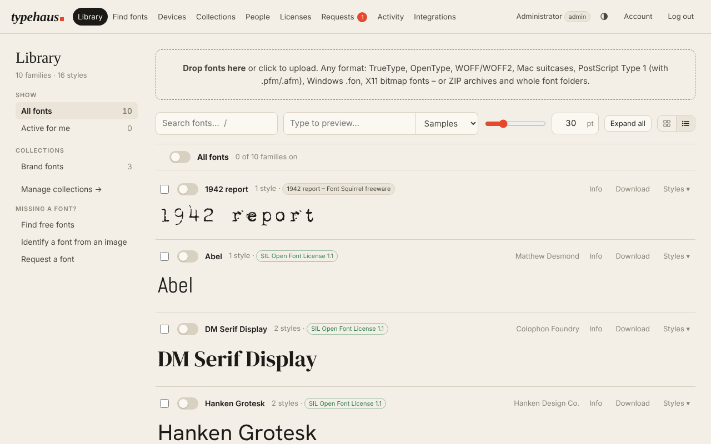
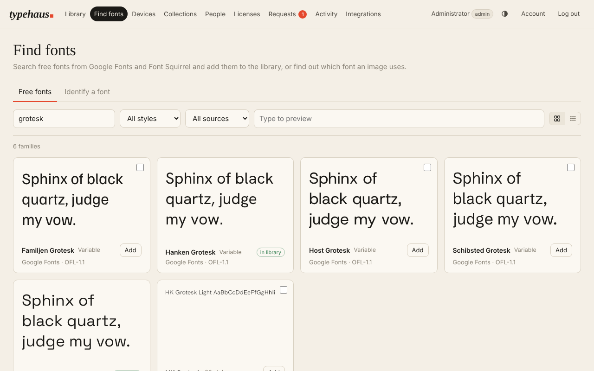
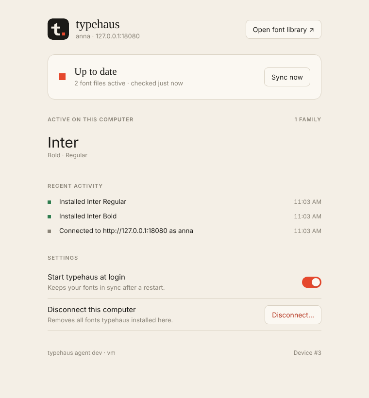
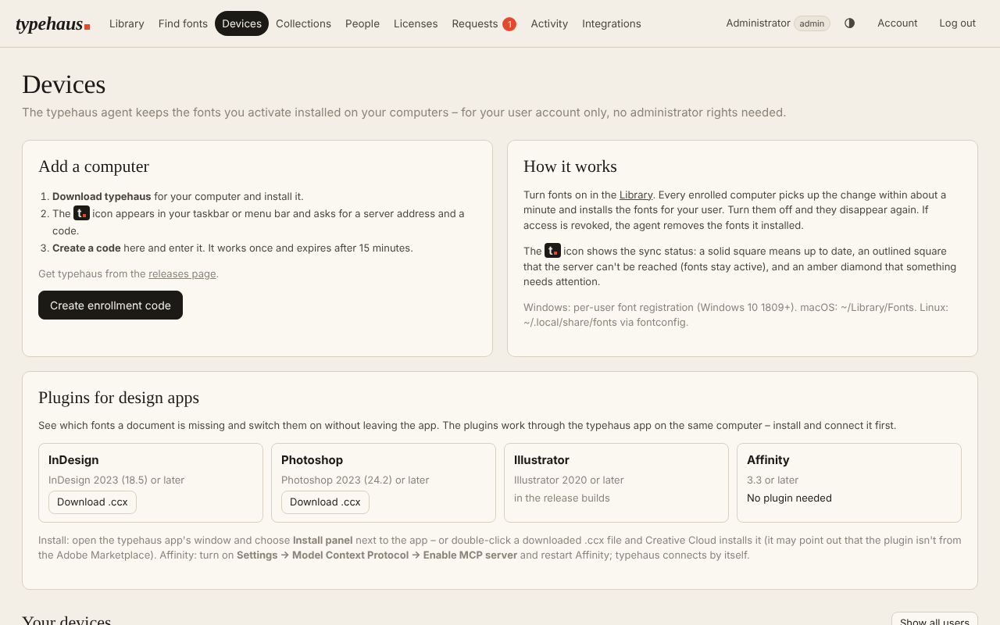

# typehaus

**Self-hosted font management for teams.** A central font library with collections and group permissions, plus a small tray app that activates fonts on Windows, macOS and Linux **without admin rights**. A free, open-source alternative to Extensis Universal Type Server, FontAgent Server or FontExplorer X Server – in one Docker container.

<picture>
  <source media="(prefers-color-scheme: dark)" srcset="docs/library-dark.png">
  
</picture>

## Why

Teams share fonts through network drives, USB sticks and "can you send me that font?" messages. Nobody knows who has which licensed font installed, and every new laptop needs an admin to install them. Commercial font servers solve this, but they are expensive and closed.

typehaus does the core of it, free:

- **One library, every format.** Upload single files, ZIP archives or whole font folders: TrueType, OpenType (including variable and colour fonts), collections, WOFF/WOFF2/EOT, Mac suitcases, PostScript Type 1, Windows bitmap fonts, X11 bitmap fonts (full list [below](#supported-font-formats)). Metadata (family, style, weight, designer, foundry, embedding rights) is read straight from the font. Duplicates are recognised by content, not by name: the same font in another file (a WOFF2 next to the TTF, a re-saved copy) is skipped, while weights, optical sizes, versions and same-named fonts from another vendor or under another license stay separate. Upload a new version of a font and typehaus offers to replace the old one, carrying over licenses, collections and activations. Families that a font names inconsistently are grouped automatically, and styles can be merged into or split out of families by hand. Font licenses never block an upload; embedding restrictions are shown as a badge.
- **Collections & groups.** Decide who sees what. "Brand fonts" for everyone, the licensed display family for the design group only.
- **Fonts that are simply there.** A collection is either *available* (members switch fonts on as needed) or *installed automatically*: every member's computers get its fonts without anyone lifting a finger, and they leave when someone leaves the group. Before saving, typehaus shows how many people, computers and license seats the change affects, and refuses it if an enforced license would run out of seats.
- **Font requests.** Missing a font? Users ask for it in the web UI with what they need it for; admins answer (added, or declined with a reason), and the answer shows up for the requester.
- **Activate from the browser.** Toggle a family or a single style. Every computer you enrolled installs it within a minute and removes it when you turn it off.
- **No admin rights.** Fonts are installed per user: HKCU registration on Windows, `~/Library/Fonts` on macOS, fontconfig on Linux.
- **Or download the files.** Prefer the traditional way? Download a single style, a whole family or a selection (ZIP, with Type 1 metrics files and the license documents) and install it yourself. Licenses can forbid this; enforced licenses only allow downloads to people holding a seat. `TYPEHAUS_DOWNLOADS=false` turns it off for everyone but admins.
- **Revocation that works.** Remove a user from a group, disable them, or revoke a device, and the agent removes the fonts it installed.
- **License management.** Record every license with its terms: allowed use (desktop, web, apps, e-books, video, logos), seats per user or per device, purchase and expiry dates, order reference and terms URL. Attach the EULA, invoice or certificate, and choose which documents users may open. Open-source licenses (OFL, Apache, Ubuntu Font Licence, GPL with font exception, …) are recognised from the fonts and assigned automatically; fonts from commercial foundries are suggested for review with the evidence from each file, and licenses can be set per family or per style. Choose per license whether administrators take seats. See who holds a seat, get warned before a license runs out, export a CSV for audits. Optionally **enforce** a license: no activations beyond the purchased seats, and fonts are removed from computers once the license has expired.
- **Built for audits.** Usage is recorded daily per license, so you can show the *peak* of the last 12 months (not just today's count) in a chart, the list and the CSV. Commercial licenses don't allow direct downloads unless you say so. Installs "for all users of a computer" are flagged, because a per-user license can't count them – typehaus never puts an enforced per-user license there. For licenses that only allow use while connected, an **offline limit** removes the fonts from a computer that hasn't reached the server for a set number of days; they return once it is back. The optional **inventory scan** lists copies of licensed library fonts that were installed on computers by other means.
- **Find fonts.** Search about 2,700 free families from Google Fonts, Font Squirrel and Fontsource and add them to the library in one click, complete and with their license recorded; users request them instead. **Identify a font** from an image: it goes to every identification service you have a key for (WhatFontIs, Mixfont, Aspose), and each match is checked against your library and the catalog. WhatTheFont, Identifont and others are linked.
- **Missing fonts in design apps.** Panels for **InDesign, Photoshop and Illustrator** list the fonts an open document is missing, switch on the ones the person may use and request the others. **Affinity** needs no panel: the typehaus app talks to Affinity's built-in MCP server and switches on what open documents miss, automatically or with a click.
- **Web fonts.** *Web kits* serve library fonts to your websites as WOFF2/WOFF from one stylesheet link – only fonts whose license includes web use, only to the domains you list, with page views counted against the license's monthly limit.
- **API and webhooks for other tools.** A stable, documented HTTP/JSON API (`/api/v1`, OpenAPI description included) with read-only or read & write tokens: feed font requests into your ticket system, let a document server fetch its fonts under the license rules, sync license data with procurement. Signed **webhooks** report changes, expiring licenses and seat overruns as they happen. See [docs/api.md](docs/api.md).
- **Activity log.** Uploads, activations, enrollments, sign-ins and admin changes.
- **Single sign-on.** Optional OIDC (Authentik, Keycloak, Authelia, Zitadel, Entra ID, Google…) with group sync and admin mapping. Local accounts work out of the box.
- **Small and boring to run.** A single Go binary with an embedded web UI. SQLite plus a content-addressed file store in one `/data` volume. Distroless image, no external services.

<picture>
  <source media="(prefers-color-scheme: dark)" srcset="docs/find-fonts-dark.png">
  
</picture>

## Quick start

You need [`docker-compose.yaml`](docker-compose.yaml) and a `.env` based on [`.env.example`](.env.example). At minimum, set `TYPEHAUS_BASE_URL`:

```sh
curl -LO https://raw.githubusercontent.com/4nonX/typehaus/main/docker-compose.yaml
curl -L https://raw.githubusercontent.com/4nonX/typehaus/main/.env.example -o .env
nano .env            # TYPEHAUS_BASE_URL, TYPEHAUS_ADMIN_PASSWORD
docker compose up -d
```

Using **Dockge**? Create a stack, paste the compose file and the `.env`, and deploy. The **[install guide](docs/install.md)** covers Dockge step by step, reverse proxies (Caddy, Nginx Proxy Manager, Traefik, Pangolin), backups, updates and troubleshooting.

Open the UI and sign in as `admin`. If you didn't set `TYPEHAUS_ADMIN_PASSWORD`, a random password is printed in the container log on first start. Forgot it later? `docker exec typehaus typehaus-server reset-password admin`.

Then:

1. **Library** → drop your fonts in, or add free ones under **Find fonts**.
2. **People** → create groups and users, or connect SSO.
3. **Collections** → create a collection, choose who can see it, and add fonts to it from the Library (select → *Add to collection*).
4. **Devices** → each user downloads typehaus, opens it, and connects with a one-time code.

Put typehaus behind your reverse proxy with HTTPS. Allow uploads of a few hundred MB there; the [install guide](docs/install.md#reverse-proxy-and-https) has examples.

## Supported font formats

| Format | Files | Installed on |
|---|---|---|
| TrueType / OpenType, incl. variable, colour (COLR, SVG, sbix) and bitmap-in-OpenType | `.ttf` `.otf` `.otb` | Windows, macOS, Linux |
| Collections | `.ttc` `.otc` | Windows, macOS, Linux |
| Web fonts: converted to TTF/OTF on upload | `.woff` `.woff2` `.eot` | Windows, macOS, Linux |
| Mac fonts: `.dfont`, and suitcases or LWFN inside a ZIP made on a Mac (the resource fork travels in `__MACOSX`): converted on upload | `.dfont`, suitcases | Windows, macOS, Linux (Type 1 outlines: see below) |
| PostScript Type 1, with `.pfm` (Windows) and/or `.afm` metrics: upload them together | `.pfb` `.pfa` `.t1` + `.pfm` `.afm` | Linux; Windows when the `.pfm` is included |
| Windows bitmap and vector fonts | `.fon` `.fnt` | Windows, Linux |
| X11 bitmap fonts (also gzip-compressed) | `.pcf` `.bdf` `.pcf.gz` | Linux |

Each computer only receives the formats its system can install. The library marks fonts that are limited to some systems. Desktop systems can't install SVG fonts at all; convert them to OpenType. CI checks every font in the system font folders of Windows, macOS and Linux against the importer on every change.

## The typehaus app (agent)



typehaus runs on each computer as a small tray / menu-bar app. The Docker image ships it for every platform, so users download it from **your** server (Devices page). This also works in air-gapped networks. It is also attached to every [GitHub release](https://github.com/4nonX/typehaus/releases).

**Getting started on a computer:**

1. Download the installer from the Devices page and install typehaus:
   - **Windows:** `typehaus-setup-windows.exe` – installs for your user account without administrator rights (Intel/AMD and ARM), with a Start menu entry and an entry under *Settings → Apps*.
   - **macOS:** `typehaus-macos.dmg` – drag typehaus to *Applications*.
   - **Linux:** `typehaus-linux-amd64.deb` (Debian, Ubuntu, Mint…) or `.rpm` (Fedora, openSUSE…); ARM packages under *Other downloads*.
2. Start typehaus. The **t.** icon appears in the taskbar or menu bar, and the typehaus window opens.
3. In the web UI under **Devices → Create enrollment code**, copy the server address and code into the window and click **Connect**.

That's it. Fonts you switch on in the library appear within a minute. *Start at login* is turned on automatically.

**Updates** use the same installer: download the new version (the app shows *Update available*) and install it over the old one. typehaus is closed, updated and started again; your fonts stay installed. **Uninstalling** (Windows: *Settings → Apps*; macOS: move the app to the bin after *Disconnect* in its window; Linux: `typehaus unenroll`, then remove the package) removes the fonts typehaus installed.

**Rolling out to many computers:** `typehaus-setup-windows.exe /S` installs silently (Intune, GPO, scripts) and `"%LOCALAPPDATA%\Programs\typehaus\uninstall.exe" /S` removes it. Each user then connects once with an enrollment code, or enroll from a script with `typehaus-agent enroll`.

The standalone programs (`typehaus-agent-<os>-<arch>`, under *Other downloads*) need no installation – for servers, scripts and portable use.

**The tray icon is the status light:**

| Icon | Meaning |
|---|---|
| **t** + solid square | Up to date |
| **t** + blinking square | Syncing |
| **t** + outlined square | Server unreachable; your fonts stay active |
| **t** + amber diamond | Something needs attention (see the window) |
| dimmed **t** | Not connected |

The menu offers *Open typehaus* (the window: status, installed fonts with live previews, recent activity, settings, disconnect), *Open font library*, *Sync now*, *Start at login* and *Quit*. On Windows, left-click opens the window and right-click opens the menu. The window is a local page bound to `127.0.0.1` and protected by a random token; it is only reachable from that computer.

On Linux the tray needs a StatusNotifier host (KDE, Xfce, Cinnamon, GNOME with the *AppIndicator* extension). Without one, typehaus keeps syncing in the background, and launching it again opens the window.

### Design apps

**InDesign, Photoshop, Illustrator.** The typehaus window lists the Adobe apps it finds, with an **Install panel** button (Adobe's Unified Plugin Installer Agent, which comes with Creative Cloud; without it the package opens in Creative Cloud). The packages are also on the Devices page. Open the panel in the app (*Plugins → typehaus* in InDesign and Photoshop; *Window → Extensions (Legacy) → typehaus* in Illustrator, *Window → Extensions* in versions before 2024): it lists the fonts the open document is missing –

- **Switch on** for fonts in the library the person may use; they are installed while the panel waits,
- **Request** for fonts they can't use or that aren't in typehaus.

The panels talk only to the typehaus app on the same computer (`127.0.0.1:47130`), which asks the server for the signed-in person, with the library's license rules. Photoshop on macOS lets plugins use https only; there the panel exchanges request files with the app in the typehaus folder instead.

<picture>
  <source media="(prefers-color-scheme: dark)" srcset="docs/devices-dark.png">
  
</picture>

**Affinity** (3.3 and later) has no plugin interface but a built-in MCP server. Turn it on in Affinity (*Settings → Model Context Protocol → Enable MCP server*, then restart Affinity); the typehaus app then reads the fonts of the open documents and switches on those Affinity is missing. In the window, *Fonts missing in Affinity* chooses: switch on automatically (default), only show them, or off. Fonts the person can't use can be requested from there. `typehaus-agent affinity` checks the connection once and prints what it sees.

### Windows: fonts for all users

A few older Windows applications only list fonts installed for *all* users and ignore per-user fonts. For such PCs, an administrator can additionally install the **typehaus service**, which installs the fonts of one typehaus account into `%WINDIR%\Fonts` for every user of the computer:

```powershell
# elevated PowerShell ("Run as administrator")
.\typehaus-agent-windows-amd64.exe machine enroll --server https://fonts.example.com --code ABCD-EFGH-JKLM
.\typehaus-agent-windows-amd64.exe machine install
```

- The fonts come from the account that created the enrollment code. Use a dedicated account per PC or per room (e.g. `pc-reception`) and give it the collections that PC needs.
- The device appears with an **all users** badge, because everyone who signs in to that computer can use those fonts. Keep that in mind for licenses.
- The service runs as LocalSystem. Its configuration and device token live in `%ProgramData%\typehaus\machine`, readable only by administrators.
- The per-user tray app can run alongside it: it skips fonts the machine already has and makes newly added machine fonts available in the current session immediately. Without it, they appear at the next sign-in.
- `machine status`, `machine sync`, and `machine uninstall` (removes the service, its fonts and the enrollment).

### Command line

The same binary is a CLI for scripting and headless machines:

```sh
typehaus-agent enroll --server https://fonts.example.com --code ABCD-EFGH-JKLM
typehaus-agent autostart enable
```

| Command | What it does |
|---|---|
| *(none)* / `tray [--autostart]` | Start the tray app (what double-click does). `--autostart` doesn't open the window. |
| `enroll --server URL --code CODE [--name NAME] [--ca-file FILE]` | Connect this computer (code valid 15 min, single use). `--ca-file` trusts an internal or self-signed CA. |
| `autostart enable` / `disable` | Start at login: Run key on Windows, LaunchAgent on macOS, XDG autostart or a systemd user service on Linux. Uses the tray where available, otherwise headless `run`. |
| `run` | Sync continuously without any UI (servers, scripts). |
| `sync [--force]` | Sync once. `--force` re-verifies every installed file. |
| `status` | Show the server, user, last sync and installed fonts. |
| `inventory [--send]` | List the fonts installed outside typehaus; `--send` reports them to the server (when the server collects inventories – the app does it by itself once a day). |
| `affinity` | Check the connection to Affinity once and list the open documents' missing fonts; changes nothing. |
| `unenroll` | Remove all fonts typehaus installed, disable autostart, forget the enrollment. |
| `machine enroll\|install\|status\|sync\|uninstall` | Windows only, as administrator: fonts for all users (see above). |

**How fonts are activated (all per user, no elevation):**

| OS | Files | Activation |
|---|---|---|
| Windows 10 1809+ / 11 | `%LOCALAPPDATA%\typehaus\fonts` | Registered under `HKCU\…\Windows NT\CurrentVersion\Fonts`, loaded into the session with `AddFontResourceW`, `WM_FONTCHANGE` broadcast |
| macOS 11+ | `~/Library/Fonts/typehaus-*` | Picked up automatically by the system font service |
| Linux / BSD | `~/.local/share/fonts/typehaus/` | `fc-cache` refresh |

Behaviour worth knowing:

- **Offline:** if the server is unreachable, fonts stay active and the agent retries with backoff. Exception: fonts whose license has an *offline limit* are paused after that many days without contact (or when the clock is set back) and come back with the next successful sync.
- **Revoked device or disabled user:** the agent removes everything it installed and returns to "not connected".
- **Fonts in use:** a font that can't be removed because an application has it open (Windows) is retried on every sync.
- **Integrity:** every download is verified against its SHA-256. Missing or damaged files are reinstalled automatically.
- Only files the agent installed itself are ever touched. Your own fonts are left alone. (If the server enables the inventory scan, their names and checksums are reported once a day – never the files.)
- **Signing:** the release pipeline signs Windows builds (SignPath Foundation) and signs and notarizes macOS builds (Apple Developer ID) once the credentials are configured; see [docs/signing.md](docs/signing.md). Until then, Windows SmartScreen asks once (*More info → Run anyway*). On macOS, move typehaus.app to *Applications* first; then on macOS 15+ open it once and go to *System Settings → Privacy & Security → Open Anyway*, or on older macOS right-click → *Open*.
- **Updates:** when the server runs a newer version, the app shows *Update available* in its menu and window. The new download replaces the running app and takes over *Start at login*.
- **Account disabled:** the app removes its fonts but stays connected; they come back automatically when the account is enabled again. Revoking a device or deleting the user disconnects it for good.
- **Duplicate fonts:** files with the same PostScript name (e.g. two versions of a family) are marked in the library, and only one of them can be active per user. Activating one switches the other off. *Make current version* replaces the others with the selected one.

## Configuration

All settings are environment variables.

| Variable | Default | Description |
|---|---|---|
| `TYPEHAUS_BASE_URL` | – | Public URL, e.g. `https://fonts.example.com`. Required for OIDC; used in enrollment commands. |
| `TYPEHAUS_LISTEN` | `:8080` | Listen address |
| `TYPEHAUS_DATA` | `/data` (image) | Database and font storage |
| `TYPEHAUS_ADMIN_USER` | `admin` | Initial admin username (first start only) |
| `TYPEHAUS_ADMIN_PASSWORD` | random | Initial admin password (first start only; logged if generated) |
| `TYPEHAUS_TRUST_PROXY` | `false` | Trust `X-Forwarded-For` / `X-Forwarded-Proto` |
| `TYPEHAUS_SECURE_COOKIES` | auto | `true` when `BASE_URL` is https |
| `TYPEHAUS_SESSION_HOURS` | `168` | Web session lifetime |
| `TYPEHAUS_POLL_SECONDS` | `60` | How often agents check for changes (min. 10) |
| `TYPEHAUS_MAX_UPLOAD_MB` | `512` | Max size of one upload request |
| `TYPEHAUS_DOWNLOADS` | `true` | Let users download font files directly (this switch never applies to admins). Per-license setting on top, which applies to admins too unless the license is set not to count them. Downloaded fonts are outside typehaus' control: they aren't removed on revocation. |
| `TYPEHAUS_INVENTORY` | `false` | Ask the apps to report, once a day, the fonts installed on each computer outside typehaus (names, sizes, checksums – never the files). Copies of licensed library fonts are listed on the Licenses page. Tell your users before you turn it on. |
| `TYPEHAUS_LOCAL_LOGIN` | `true` | Set `false` to allow SSO only (requires `TYPEHAUS_OIDC_GROUPS_CLAIM` and `TYPEHAUS_OIDC_ADMIN_GROUP`) |
| `TYPEHAUS_API_RATE` | `600` | API requests per token and minute |
| `TYPEHAUS_CATALOG` | `true` | Free font catalog under *Find fonts*. Needs internet access (Fontsource, Font Squirrel, GitHub); set `false` on air-gapped servers. |
| `TYPEHAUS_IDENTIFY` | `true` | *Identify a font* from an image |
| `TYPEHAUS_WHATFONTIS_KEY`, `TYPEHAUS_MIXFONT_KEY`, `TYPEHAUS_ASPOSE_CLIENT_ID` / `_SECRET` | – | Keys of identification services. Admins can also enter them under *Integrations → Services*; the variables take precedence. Uploaded images are sent to these services. |
| `TYPEHAUS_AGENTS_DIR` | `/app/agents` (image) | Agent binaries and app plugins offered on the Devices page |

### Single sign-on (OIDC)

| Variable | Description |
|---|---|
| `TYPEHAUS_OIDC_ISSUER` | Issuer URL (discovery via `/.well-known/openid-configuration`) |
| `TYPEHAUS_OIDC_CLIENT_ID` / `TYPEHAUS_OIDC_CLIENT_SECRET` | Client credentials |
| `TYPEHAUS_OIDC_NAME` | Button label, e.g. `Authentik` |
| `TYPEHAUS_OIDC_GROUPS_CLAIM` | Claim with group names (e.g. `groups`). Users are placed into typehaus groups **with the same name** at every login. Groups assigned by hand in typehaus are kept. |
| `TYPEHAUS_OIDC_ADMIN_GROUP` | Members of this IdP group become typehaus admins (requires the groups claim) |
| `TYPEHAUS_OIDC_AUTO_CREATE` | `true`: create accounts on first login. `false`: only pre-created users may sign in. |

Redirect URI: `https://fonts.example.com/auth/oidc/callback`. The login uses the authorization code flow with PKCE and a nonce. An existing local user with the same username is linked on their first SSO login.

**Active Directory / LDAP:** put an IdP that speaks OIDC in front of your directory (Authentik, Keycloak, Authelia and Zitadel all federate LDAP/AD) and use the variables above.

## API

typehaus has a stable HTTP/JSON API under `/api/v1` for other tools. An administrator creates a token under **Integrations → API tokens** (read, or read & write), and the tool sends it as `Authorization: Bearer thk_…`:

```sh
curl -H "Authorization: Bearer thk_…" https://fonts.example.com/api/v1/licenses
```

The server describes every endpoint at `/api/v1/openapi.json` (OpenAPI 3.1). Within version 1 the API changes only compatibly; a test against the published contract enforces it. **Webhooks** (*Integrations → Webhooks*) send signed events to your URL. Details and examples: [docs/api.md](docs/api.md).

## Backups

Everything lives in `/data`: `typehaus.db` (SQLite) and `fonts/` (content-addressed files). See the [install guide](docs/install.md#backup-and-restore) for a backup command that works while typehaus is running.

## Security notes

- Passwords are hashed with bcrypt (recovery: `typehaus-server reset-password NAME`, also via `docker exec`). Failed logins and enrollment attempts trigger an increasing lockout per client.
- Web sessions use HttpOnly, SameSite cookies. State-changing API calls require a custom header (CSRF protection). Strict CSP.
- Device tokens and enrollment codes are stored only as SHA-256 hashes. Enrollment codes are single use and expire after 15 minutes.
- Agents can only download fonts that are currently active **and** visible to their user.
- Uploads are validated as fonts before they are stored. Web and Mac container formats (WOFF/WOFF2/EOT, suitcases) are converted to plain TrueType/OpenType first.

Found a vulnerability? Please open a private security advisory on GitHub rather than a public issue.

## Compared to commercial font servers

typehaus covers the core workflow: central library, permissions, per-user activation, revocation and license visibility. Not included (yet):

- Plugins for QuarkXPress, CorelDRAW and Office (InDesign, Photoshop, Illustrator and Affinity are covered)
- InDesign Server / prepress integrations
- Font corruption reports (fonts installed outside typehaus are found by the optional inventory scan, but not repaired or removed)
- Activating and browsing fonts directly from the tray app (today the library lives in the web UI)

Contributions are very welcome, especially plugins for more apps.

## Development

```sh
go test ./...
TYPEHAUS_DATA=./data TYPEHAUS_ADMIN_PASSWORD=adminadmin1 go run ./cmd/typehaus-server
# in another terminal
TYPEHAUS_AGENT_HOME=/tmp/th-agent go run ./cmd/typehaus-agent enroll --server http://localhost:8080 --code …
```

Layout:

```
cmd/typehaus-server     server entrypoint
cmd/typehaus-agent      agent CLI (tray, headless, Windows service)
internal/server         HTTP API, auth, storage, embedded web UI (internal/server/web)
internal/agent          sync engine, per-OS activation and autostart, controller
internal/agent/tray     tray / menu-bar UI
internal/agent/ui       local agent window (127.0.0.1)
internal/adobeplugins   InDesign, Photoshop (UXP) and Illustrator (CEP) panels
internal/brand          the typehaus mark: pixel-snapped icon renderer, ICO/SVG output
internal/fontmeta       dependency-free OpenType reader, WOFF/WOFF2 encoder
internal/protocol       agent ⇄ server wire format
```

The web UI and the agent window are plain HTML/CSS/JS with no build step.

End-to-end test against a real server, on the current OS (CI runs it on Linux, Windows incl. the all-users service, and macOS):

```sh
go build -o bin/ ./cmd/... ./tools/e2e
bin/e2e -server bin/typehaus-server -agent bin/typehaus-agent -font testdata/fonts/Poppins-Regular.ttf
```

Icons and brand files are generated from `internal/brand`:

```sh
go run ./tools/iconsheet -o iconsheet.png   # review sheet: every state, size and background
go run ./tools/brandassets                  # regenerate favicon, app icons, macOS iconset
```

Building the Windows resources (icon, manifest) after changing them: `go run github.com/tc-hib/go-winres@v0.3.3 make --in cmd/typehaus-agent/winres/winres.json --out cmd/typehaus-agent/rsrc --arch amd64,arm64`. The macOS tray needs cgo and is built on macOS by `packaging/macos/build-app.sh`.

See [CHANGELOG.md](CHANGELOG.md) for what changed in each release.

## License

[GNU AGPL-3.0](LICENSE). You can use, self-host and modify typehaus freely, including inside companies. If you offer a modified version to others over a network, you must publish your changes.
